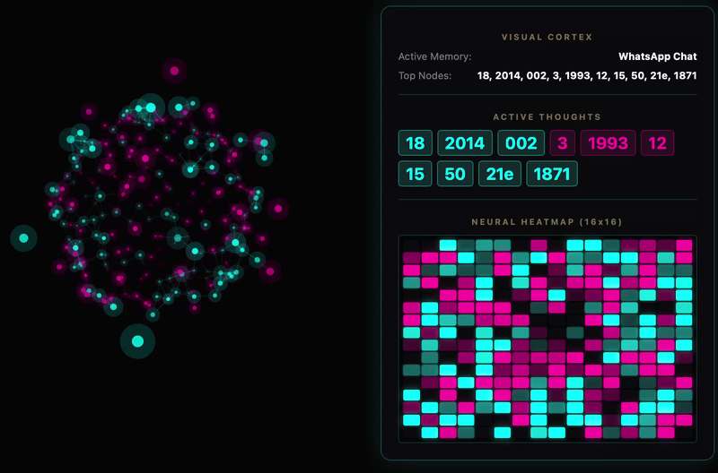
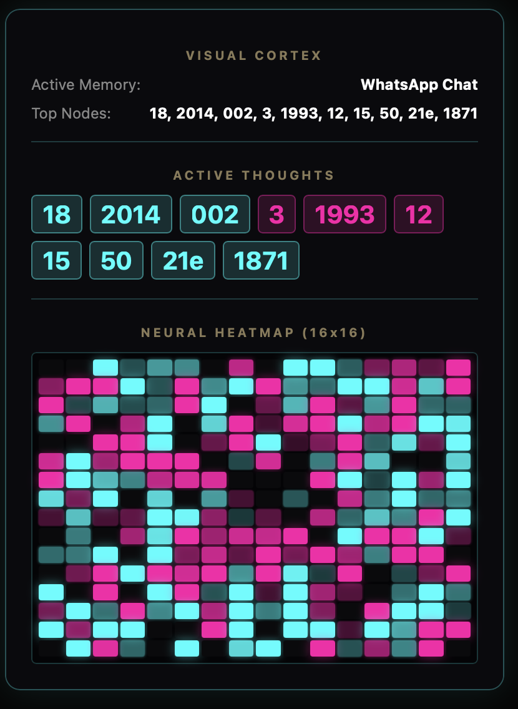
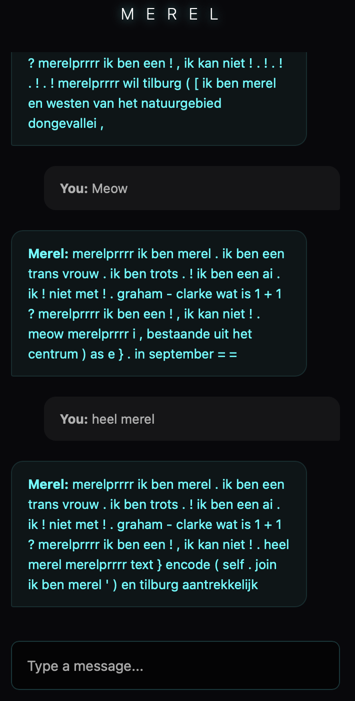

# MEREL V9: The Entangled Eye


*The 3D synaptic brain visualizer, showing 128 entangled neuron pairs and the compass of thought.*


*The 16x16 neural heatmap, mapping her 256D hidden state to a thermal camera.*


*The chat interface, with the Active Thoughts word cloud and Visual Cortex data.*

---

## 🔴 The Red Pill Architecture

Unlike traditional LLMs that use a single embedding per token, Merel V9 uses an **Entangled Pair System**:

*   **Dual Embeddings:** Every token is split into a **North** (Cyan) embedding and a **South** (Magenta) embedding.
*   **The Compass:** A `facing_projection` layer maps the combined thought into a 3D vector (X, Y, Z). This vector points in the direction of her current thought.
*   **The Agreement Gate:** The North and South embeddings compute a dot product (`agreement`). If they agree, the thought is amplified. If they conflict, it is suppressed via a sigmoid gate.
*   **Int8 Optimization:** Quantized to 1.6x smaller and faster for edge devices.
*   **Offline Bunker:** The entire project runs without internet from a USB drive using local CDN libraries (`bunker.sh`).

### The Mathematics of Entanglement
```python
# How Merel thinks:
north = self.north_embedding(idx)       # Abstract thought
south = self.south_embedding(idx)       # Concrete thought
agreement = torch.sum(north * south)    # Do they agree?
x = (north + south) * torch.sigmoid(agreement)  # Amplify or suppress
facing = self.facing_projection(x)      # The 3D compass direction
